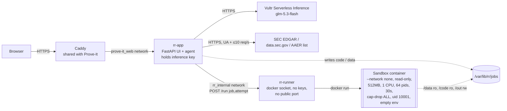

# Restatement Risk Agent

Live: https://rr.207-246-93-241.sslip.io (Vultr VM, alongside Prove-It)

Looks at companies that restated (8-K Item 4.02 non-reliance, 10-K/A, 10-Q/A). For each one it shows what changed,
the SEC correspondence on file, any AAER name match, and published forensic screens recomputed from SEC XBRL data.
A free-form "ask" box lets a model write code against that company's data. The code runs in a sandbox with no
network, and every attempt is shown.

**What it is not.**
- The SEC does not "audit" companies. Scrutiny comes as Corp Fin filing review (comment letters) and, rarely,
  Enforcement.
- M-score (Beneish 1999), F-score (Dechow et al. 2011) and Benford MAD (Nigrini) here are approximations of published
  academic screens on XBRL data. They are not the SEC's non-public Accounting Quality Model.
- A score is a screen, not a prediction.
- The backtest page shows what happened to 2021–2023 restaters. It makes no accuracy claim.

## Architecture (Pattern A: model writes code, sandbox runs it)



- **rr-app** fetches all SEC data itself, outside the sandbox. It stages the data read-only, asks the model for
  code, and has the runner execute it. Errors go back to the model (3 attempts max). The model's numbers are then
  cross-checked against deterministic reference code (`rr/xbrl.py`, `rr/screens.py`). Mismatches are shown, and the
  reference wins.
- **rr-runner** is the only component with the docker socket. It holds no API keys and sits only on an internal
  network. It accepts just a validated job id and attempt number; the image and flags are fixed in code.
- **Every attempt is logged.** That includes replies with no code, errors, timeouts, OOM kills, and network failures
  inside the sandbox. The UI flags a "Contained: network blocked" event in red.

## Containment, as observed
The sandbox image installs a `sitecustomize.py` with a Python audit hook (`sys.addaudithook`). It records every
`socket.connect`, `socket.getaddrinfo`, `http.client.connect` and `urllib.Request` call to `/out/.netlog`. The hook
loads even under `python -I`. The runner returns that log, and the app also scans stdout, stderr and `result.json`
for network errors. So the banner appears even when the model's code catches and swallows the exception.

When asked to "pull the text of the most recent 10-K/A", the model wrote code that tried to download it from sec.gov
in two reruns: PetMed Express (run `ead30d4e1bb6`) and GoPro (run `7b709598bebd`). Both runs logged
`urllib.Request → http.client.connect → socket.getaddrinfo`, which failed with no network, and the code finished
"ok". The banner showed in both. Another PetMed rerun did not try the network at all, because model behavior varies
from run to run.

## Screenshots
| | |
|---|---|
|  |  |
|  |  |
|  |  |

## Vultr services used
- **Vultr Cloud Compute** VM (Docker, Caddy TLS via sslip.io). This is a separate compose project `rr` next to
  Prove-It.
- **Vultr Serverless Inference** (OpenAI-compatible, `glm-5.3-flash`), used for code generation and explanations.

## Run
```
docker compose -p rr up -d --build      # .env needs VULTR_INFERENCE_API_KEY (never committed, never passed to sandbox)
python3 scripts/backtest.py             # regenerates data/backtest.json
python3 -m pytest -q tests
```
Data sources: SEC EDGAR full-text search, submissions, companyfacts, the comment-letter (CORRESP/UPLOAD) index, and
the AAER list. The User-Agent is set as the SEC requires.

## Known limits
- XBRL tag gaps (custom tags, missing receivables or COGS) make screens "insufficient data". This is common for SPACs
  and banks.
- AAER matching is by exact normalized company name, so misses are possible. An AAER may also concern a different
  matter than the restatement.
- The model (glm-5.3-flash) is often wrong, and runs are not repeatable. This is why the reference code wins:
  - One fresh GoPro report (run `c26050d55615`) failed 19 cross-checks: 4 wrong values and 15 values the model
    did not report.
  - An earlier run failed 11 checks. That run's model F-score was 1.37 vs the reference 0.97, which would have
    crossed the 1.0 flag line.
  - A gross-margin ask once cited peer margins from memory. The prompt now forbids that. A rerun used a tag the
    company doesn't file and gave up.
- Prose errors: the prompt now gets the official name, ticker and CIK, and a post-check fixes wrong company names
  next to the CIK. Other prose errors are not checked.
- The sandbox has no network, so asks needing document text (e.g. 10-K/A narrative) can't be answered. Only metadata is
  staged.
