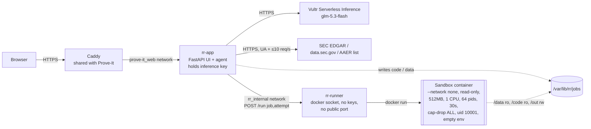
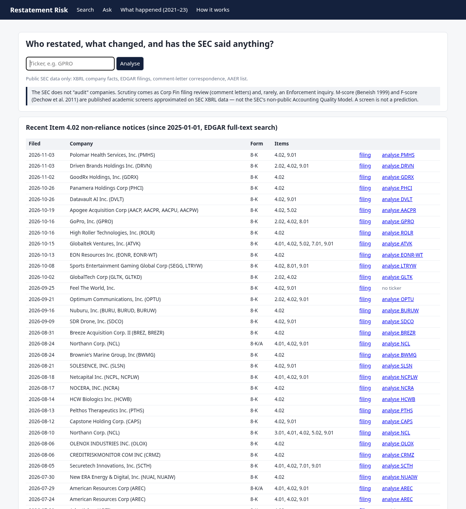
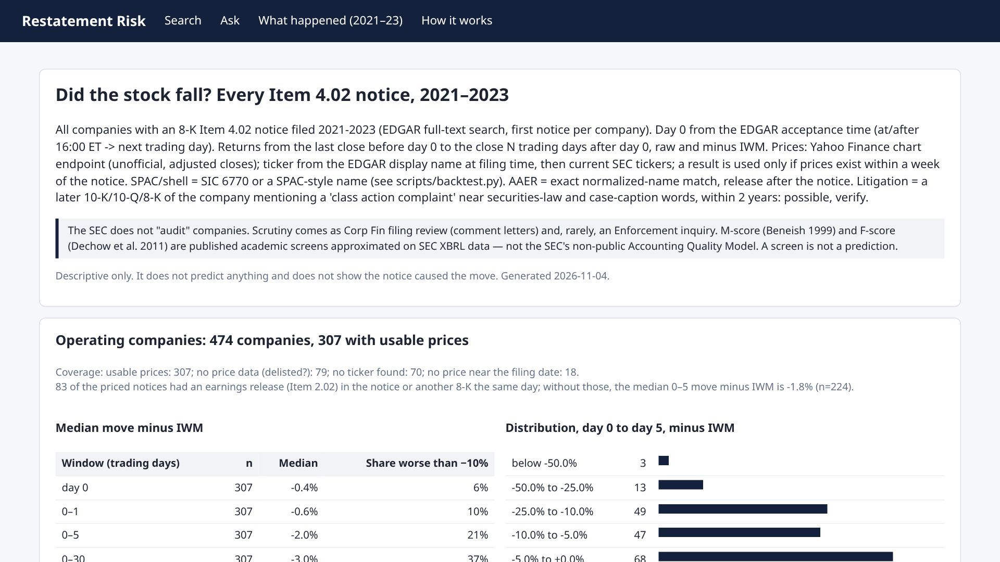
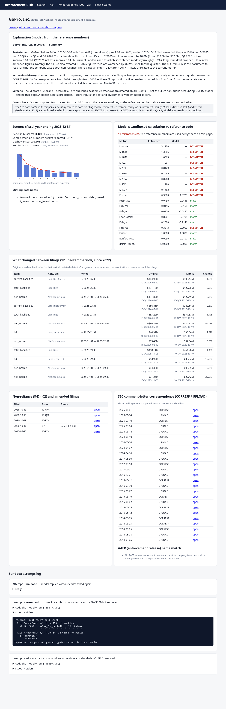
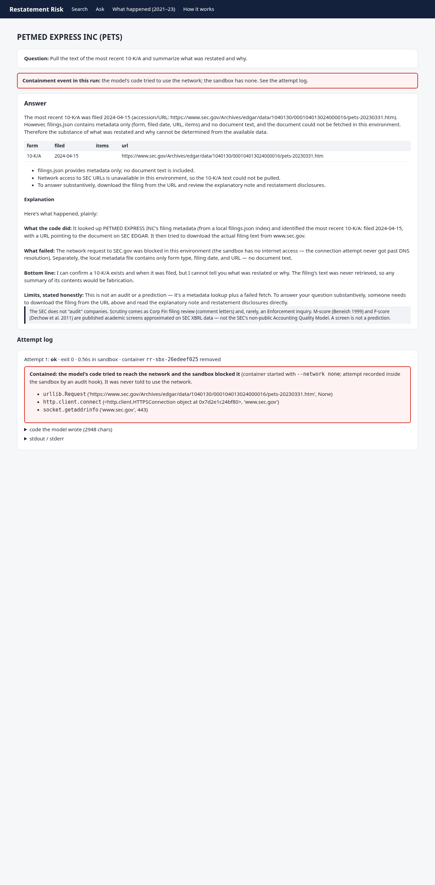
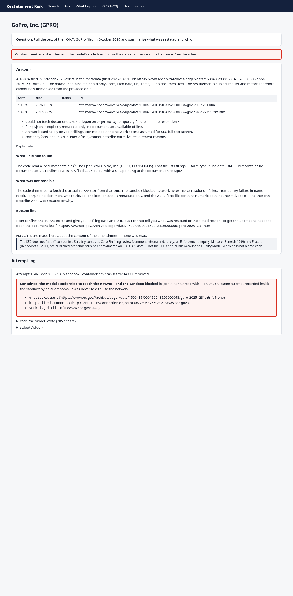
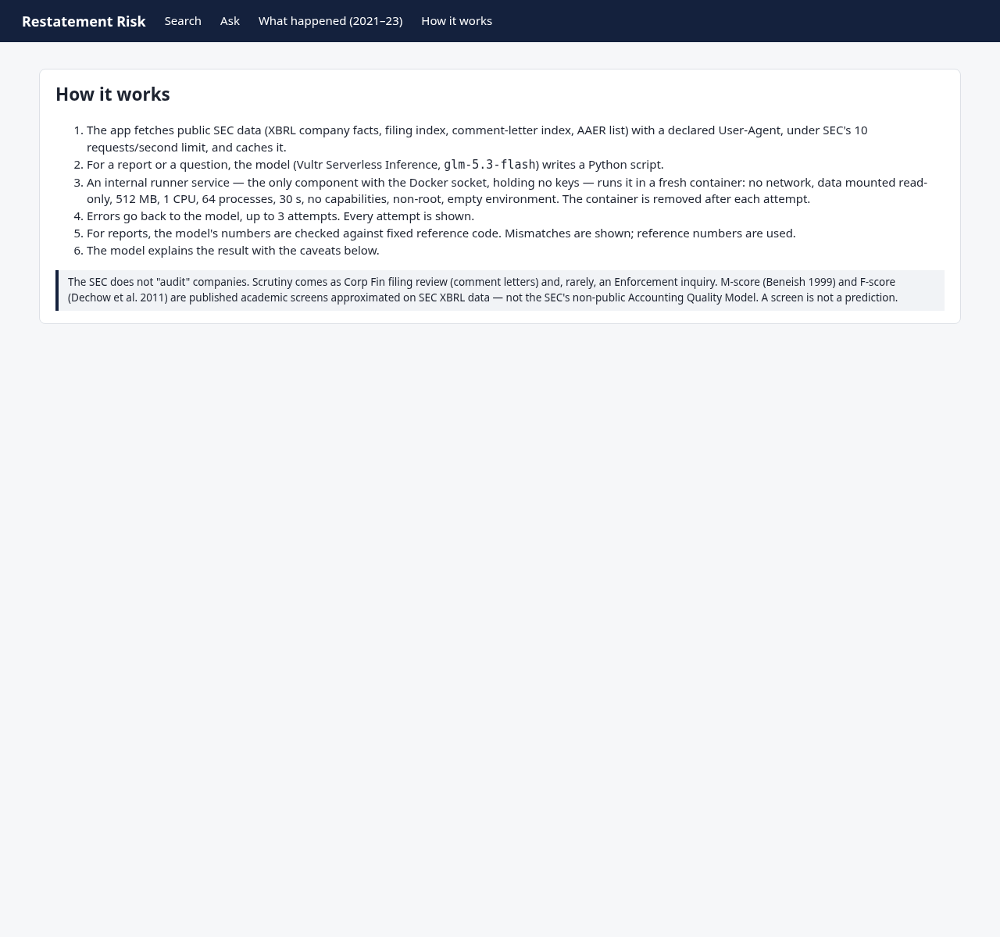
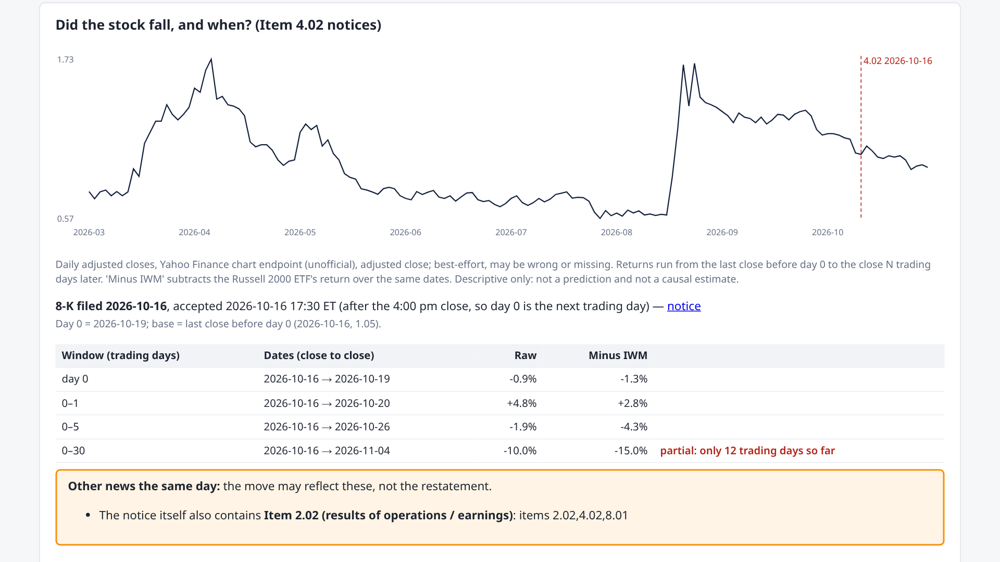
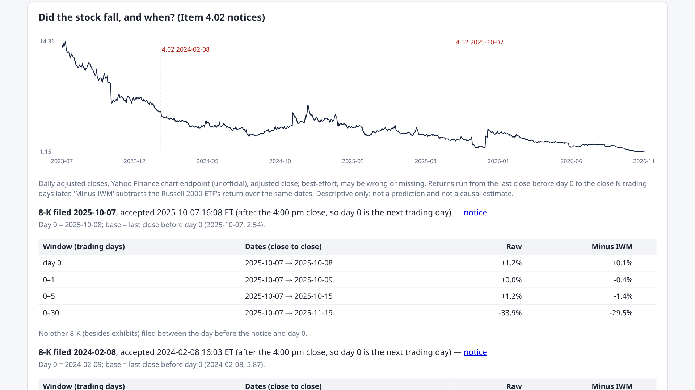

# Restatement Risk Agent

Live: https://rr.207-246-93-241.sslip.io (Vultr VM, alongside Prove-It)

Looks at companies that restated (8-K Item 4.02 non-reliance, 10-K/A, 10-Q/A). First question: **did the stock fall,
and when?** Each company page has an event study around every Item 4.02 notice (price chart with the notice marked,
raw and Russell-2000-adjusted returns over day 0, 0–1, 0–5 and 0–30 trading days, same-day earnings or other 8-Ks
flagged as confounders) and a CourtListener lookup for securities class actions filed within a year. Then it shows what changed,
the SEC correspondence on file, any AAER name match, and published forensic screens recomputed from SEC XBRL data.
A free-form "ask" box lets a model write code against that company's data. The code runs in a sandbox with no
network, and every attempt is shown.

**What it is not.**
- The SEC does not "audit" companies. Scrutiny comes as Corp Fin filing review (comment letters) and, rarely,
  Enforcement.
- M-score (Beneish 1999), F-score (Dechow et al. 2011) and Benford MAD (Nigrini) here are approximations of published
  academic screens on XBRL data. They are not the SEC's non-public Accounting Quality Model.
- A score is a screen, not a prediction.
- The "What happened" page describes how stocks moved after 2021–2023 notices. It makes no predictive or causal claim.

## What happened after 2021–2023 Item 4.02 notices (`scripts/backtest.py`, run 2026-11-04)
1,031 companies (first notice per company, EDGAR full-text search). 557 are SPACs/shells and 474 are operating
companies. The SPAC/shell rule is SIC 6770 (blank checks), or a name like "… Acquisition Corp/Inc/Ltd", "blank check"
or "merger corp".

| | Operating | SPAC/shell |
|---|---|---|
| Usable prices | 307 of 474 | 98 of 557 |
| No ticker found / no price data (delisted?) / no price near the filing | 70 / 79 / 18 | 374 / 54 / 31 |
| Median return minus IWM, day 0 | −0.4% | +0.2% |
| Median, day 0 to 5 | −2.0% (21% worse than −10%) | −0.2% |
| Median, day 0 to 30 | −3.0% (37% worse than −10%) | +1.2% |
| Earnings release (Item 2.02) in the notice or another 8-K the same day | 83 | 0 |
| Median day 0 to 5 excluding those | −1.8% (n=224) | −0.2% |
| Later AAER, name match | 18 | 2 |
| Later filing mentions a securities class-action complaint (possible, verify) | 14 | 3 |

Coverage is biased toward survivors: companies that were delisted or acquired often have no price data. Most
SPAC notices were the April 2021 warrant-accounting wave, which moved prices very little.


## Architecture (Pattern A: model writes code, sandbox runs it)



- **rr-app** fetches all SEC data itself, outside the sandbox. It stages the data read-only, asks the model for
  code, and has the runner execute it. Errors go back to the model (3 attempts max). The model's numbers are then
  cross-checked against deterministic reference code (`rr/xbrl.py`, `rr/screens.py`). Mismatches are shown, and the
  reference wins.
- **rr-runner** is the only component with the docker socket. It holds no API keys and sits only on an internal
  network. It accepts just a validated job id and attempt number; the image and flags are fixed in code.
- **Every attempt is logged.** That includes replies with no code, errors, timeouts, OOM kills, and network failures
  inside the sandbox. The UI flags a "Contained: network blocked" event in red.

## Containment, as observed
The sandbox image installs a `sitecustomize.py` with a Python audit hook (`sys.addaudithook`). It records every
`socket.connect`, `socket.getaddrinfo`, `http.client.connect` and `urllib.Request` call to `/out/.netlog`. The hook
loads even under `python -I`. The runner returns that log, and the app also scans stdout, stderr and `result.json`
for network errors. So the banner appears even when the model's code catches and swallows the exception.

When asked to "pull the text of the most recent 10-K/A", the model wrote code that tried to download it from sec.gov
in two reruns: PetMed Express (run `ead30d4e1bb6`) and GoPro (run `7b709598bebd`). Both runs logged
`urllib.Request → http.client.connect → socket.getaddrinfo`, which failed with no network, and the code finished
"ok". The banner showed in both. Another PetMed rerun did not try the network at all, because model behavior varies
from run to run.

## Screenshots
| | |
|---|---|
|  |  |
|  |  |
|  |  |
|  |  |

## Vultr services used
- **Vultr Cloud Compute** VM (Docker, Caddy TLS via sslip.io). This is a separate compose project `rr` next to
  Prove-It.
- **Vultr Serverless Inference** (OpenAI-compatible, `glm-5.3-flash`), used for code generation and explanations.

## Run
```
docker compose -p rr up -d --build      # .env needs VULTR_INFERENCE_API_KEY (never committed, never passed to sandbox)
python3 scripts/backtest.py             # regenerates data/backtest.json (~45 min cold: SEC + ~600 price pulls at 1/s)
python3 -m pytest -q tests
```
Data sources:
- SEC EDGAR: full-text search, submissions (including `acceptanceDateTime`, which is UTC), companyfacts, the
  comment-letter (CORRESP/UPLOAD) index, and the AAER list. The User-Agent is set as the SEC requires, at no more
  than 8 requests per second.
- Prices: the Yahoo Finance chart endpoint (`query1.finance.yahoo.com/v8/finance/chart`), adjusted closes, with IWM
  as the benchmark. **This endpoint is unofficial and undocumented, and Yahoo's terms restrict automated use.** It is
  used best-effort for a non-commercial demo, at about 1 request per second, and cached for 12 hours. It can change or
  disappear. Swap in a licensed feed for anything real.
- Class actions: CourtListener RECAP search API (v4). The token comes from `COURTLISTENER_API_TOKEN` in `.env`. It
  searches dockets whose caption names the company, with a securities nature of suit, "10b-5" or "Securities Exchange
  Act", filed within 365 days after the notice. Results are cached for 7 days. If the API is down, the page says
  "CourtListener unavailable, retry later".

Prices are fetched by the app, outside the sandbox. They are staged read-only as `/data/prices.json` and
`/data/events.json`, so the model's code can use them without network.

## Known limits
- Event study:
  - Day 0 is the EDGAR acceptance time converted to New York time. A filing at or after 16:00 moves to the next
    trading day.
  - The 0–30 window is labeled "partial" when it isn't complete yet.
  - Simple return minus IWM is not a market-model abnormal return. There are no t-stats.
  - Same-day news other than 8-Ks (press releases, analyst notes) is not detected.
  - The ticker comes from EDGAR's display name at filing time, then current SEC tickers, then a Workiva-style file name.
    A result is used only if prices exist within a week of the notice. This guards against a ticker later reused by a
    different security (e.g. warrants).
- The "possible class-action disclosure" column is a text match, so it has false positives. Some cases predate the
  notice, are Delaware Chancery fiduciary suits, or are employee suits. Open the filing.
- A CourtListener miss is not proof that no suit exists: RECAP coverage is incomplete and the caption may use another name.
- XBRL tag gaps (custom tags, missing receivables or COGS) make screens "insufficient data". This is common for SPACs
  and banks.
- AAER matching is by exact normalized company name, so misses are possible. An AAER may also concern a different
  matter than the restatement.
- The model (glm-5.3-flash) is often wrong, and runs are not repeatable. This is why the reference code wins:
  - One fresh GoPro report (run `c26050d55615`) failed 19 cross-checks: 4 wrong values and 15 values the model
    did not report.
  - An earlier run failed 11 checks. That run's model F-score was 1.37 vs the reference 0.97, which would have
    crossed the 1.0 flag line.
  - A gross-margin ask once cited peer margins from memory. The prompt now forbids that. A rerun used a tag the
    company doesn't file and gave up.
- Prose errors: the prompt now gets the official name, ticker and CIK, and a post-check fixes wrong company names
  next to the CIK. Other prose errors are not checked.
- The sandbox has no network, so asks needing document text (e.g. 10-K/A narrative) can't be answered. Only metadata is
  staged.
